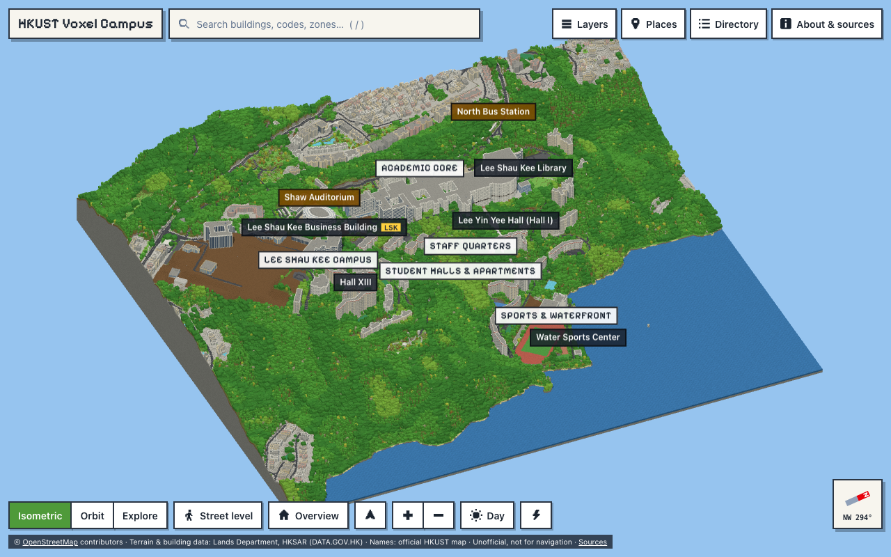

# HKUST Voxel Campus

**A data-informed block-scale digital recreation of The Hong Kong University of Science and Technology.**

A standalone interactive website that presents the HKUST Clear Water Bay campus as one connected,
explorable voxel world: block-stepped real terrain from the hilltop entrance down to Port Shelter,
real road and path networks, building footprints rebuilt as block architecture with official
heights, dense hillside woodland, the sea, and day / sunset / night lighting — at
**1 block = 1 metre**.

It is **not** a game world, mod, server or download, it needs no game installation, and it uses
**no game assets**: every texture is generated procedurally in [`src/lib/voxel/textures.ts`](src/lib/voxel/textures.ts).

> Unofficial. Not affiliated with or endorsed by HKUST. **Not for navigation, accessibility
> planning, safety or operational decisions.** See [docs/ACCURACY.md](docs/ACCURACY.md).



## What you can do

- Land on an orthographic three-quarter overview, then orbit, pan and zoom.
- Switch between **Isometric** (orthographic), **Orbit** (perspective) and **Explore** (first-person
  walk / run / fly with terrain following and building collision), plus **Street level**.
- Search by English or Chinese name, building abbreviation (`CYT`, `LSK`, `IAS`), zone, landmark
  or road; the camera flies there, the building pulses and an inspector opens.
- Click any building for its name, zone, model tier, geometry and height confidence.
- Toggle layers (labels, terrain, buildings, trees, roads, paths & stairs, landmarks, points of
  interest, campus zones, source-confidence overlay), time of day and performance mode.
- Share the exact view: the URL always encodes camera, selection, layers and time.

## Local setup

Requires Node.js 20+ (developed on Node 22 LTS).

```bash
npm install
```

```bash
npm run dev
```

Open the printed `http://localhost:5175`. The repository ships the generated world in
`public/world/`, so the site runs immediately — no data download is needed just to view it.

## Commands

| Command                 | What it does                                                                                          |
| ----------------------- | ----------------------------------------------------------------------------------------------------- |
| `npm run dev`           | Development server (port 5175)                                                                        |
| `npm run build`         | Type-check and produce the static production build in `dist/`                                         |
| `npm run preview`       | Serve the production build locally (port 4175)                                                        |
| `npm run typecheck`     | TypeScript project check                                                                              |
| `npm run lint`          | ESLint                                                                                                |
| `npm run format`        | Prettier                                                                                              |
| `npm test`              | Unit tests (Vitest): projection, landmark coordinates, height hierarchy, mesher, world data, search   |
| `npm run test:e2e`      | Playwright end-to-end tests against the production build                                              |
| `npm run data:fetch`    | Refresh spatial data: OSM extract, official-name evidence, Lands Department buildings and terrain     |
| `npm run data:process`  | Raw OSM → clean grouped GeoJSON in `data/processed/`                                                  |
| `npm run data:terrain`  | Crop and resample the terrain model to the campus grid                                                |
| `npm run data:world`    | Build the block world into `public/world/`                                                            |
| `npm run data:build`    | `data:process` + `data:terrain` + `data:world`                                                        |
| `npm run data:all`      | `data:fetch` + `data:build`                                                                           |
| `npm run audit:imagery` | Cache Lands Department aerial-photo tiles as a private reference (not shipped)                        |
| `npm run audit:compare` | Side-by-side sheets, aerial photo vs. model, into `data/raw/audit/` (needs `npm run preview` running) |

First-time end-to-end setup: `npx playwright install chromium`.
Documentation screenshots: `SHOTS=1 npx playwright test e2e/screenshots.spec.ts`.
Frame-rate probe: `PERF=1 npx playwright test e2e/perf.spec.ts`.

## Data refresh workflow

1. `npm run data:fetch` — one bounded Overpass query for the study-area polygon (cached in
   `data/raw/osm-hkust.json` with the query text and timestamp), the official campus map PDF as
   evidence, the Lands Department Building polygons, and the Lands Department 5 m terrain model
   (~29 MB download, ~300 MB unpacked). Cached files are reused; pass `--force` to a fetch script
   to refresh. `data/raw/` is git-ignored. The campus boundary (`data/campus-boundary.geojson`)
   is treated as curated and never overwritten.
2. Official building names live in [`data/curated/official-hkust.json`](data/curated/official-hkust.json),
   transcribed by hand from the official map. Edit that file when the official map changes.
3. `npm run data:build` — regenerates `data/processed/*`, `data/terrain/*` and `public/world/*`.
4. `npm test` — the landmark-coordinate, grounding and tree-placement tests validate the new world.
5. Review `data/processed/build-report.json` (official ↔ OSM matches) and record any correction in
   [`data/manual-overrides.json`](data/manual-overrides.json) — every entry needs evidence,
   confidence, reason and date, or the build fails.

The published site never queries Overpass or any map service at runtime.

## Deployment (Vercel)

The site is fully static.

1. Push the repository to GitHub / GitLab / Bitbucket.
2. In Vercel choose **Add New → Project** and import the repository.
3. Vercel detects Vite. The included [`vercel.json`](vercel.json) sets build command
   `npm run build`, output directory `dist`, and cache headers. No environment variables.
4. Deploy. (CLI alternative: `npx vercel` for a preview, `npx vercel --prod` for production.)

Netlify and Cloudflare Pages work the same way: build `npm run build`, publish `dist`
(`public/_headers` provides cache headers for both).

## Source attribution

- Map geometry © [OpenStreetMap](https://www.openstreetmap.org/copyright) contributors, ODbL 1.0.
- Terrain (Digital Terrain Model, 5 m) and building names / heights (Building dataset)
  © The Government of the Hong Kong SAR, Lands Department, via DATA.GOV.HK.
- Lands Department aerial photographs were used only as a private reference for auditing the
  model; none is included.
- Official building names: the official
  [HKUST Campus Map](https://publish.ust.hk/univ/maps/Campus_Map_Color.pdf),
  © The Hong Kong University of Science and Technology (facts only; not an open dataset).
  Building abbreviations from HKUST Path Advisor.
- Pixelify Sans typeface, SIL OFL 1.1.

Full details, licence status and restrictions: [docs/DATA_SOURCES.md](docs/DATA_SOURCES.md) and
[`data/source-manifest.json`](data/source-manifest.json).

## Performance notes

- Geometry is drawn as GPU-instanced block quads (12 bytes per merged rectangle) — terrain is
  meshed in a Web Worker, nearest chunks first, so the page never freezes while loading.
- Terrain has two levels of detail; trees have three; small props are distance-culled; the
  shadow map is re-rendered only when something changes.
- The HKUST world is 1280 × 1408 blocks, with ~250 000 structure quads and ~29 000 trees.
  **Performance mode** (auto-enabled on touch devices) thins trees, disables shadows, props and
  clouds, shortens draw distance and lowers resolution.
- Shipped world data ≈ 1.3 MB of binary plus a 0.33 MB feature catalogue (before HTTP compression).

## Limitations

- **The official HKUST map has no coordinates.** Names were transcribed by hand from a schematic
  PDF and attached to OpenStreetMap footprints by name; positions are OpenStreetMap's.
- Eight names on the official map have no matching building footprint (see
  [docs/ACCURACY.md](docs/ACCURACY.md)). Seven are missing; one, mapped as a construction site, is
  shown as a marker only.
- Architecture is stylised. Only the Academic Building and the Shaw Auditorium have bespoke
  models, and the Shaw Auditorium's side elevation was not checked against a photograph.
- Heights come from Lands Department building data for 470 of 526 footprints, matched to OSM
  footprints by overlap — a few may be mis-assigned.
- The campus was audited against Lands Department aerial photographs and five mismatches were
  corrected (see [docs/ACCURACY.md](docs/ACCURACY.md)); the Academic Building's real roofscape and
  everything off campus were not.
- The 469 off-campus buildings have a generic façade; 311 buildings that no source names carry a
  descriptive street label, not a real name.
- The OpenStreetMap extract came from a mirror whose snapshot was dated 2026-07-24.

## Documentation

- [docs/DATA_SOURCES.md](docs/DATA_SOURCES.md) — every source, licence and attribution
- [docs/ACCURACY.md](docs/ACCURACY.md) — what is and is not accurate, validation results
- [docs/ARCHITECTURE.md](docs/ARCHITECTURE.md) — coordinates, pipeline, chunking, rendering
